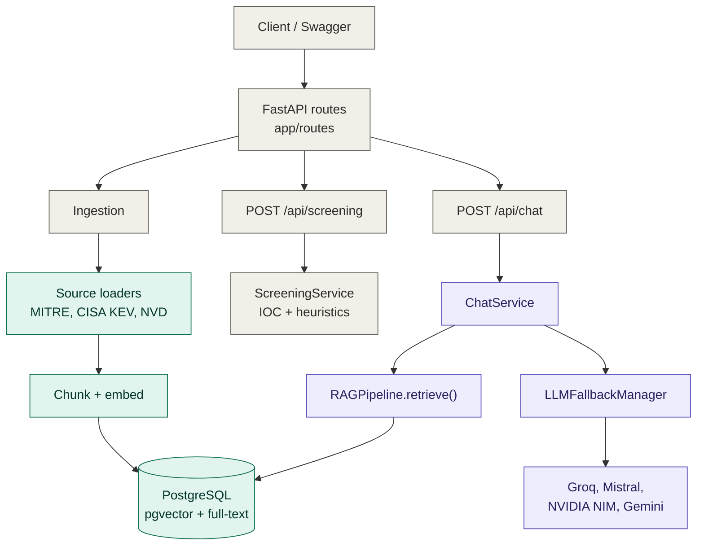
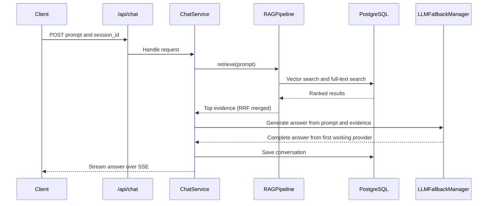
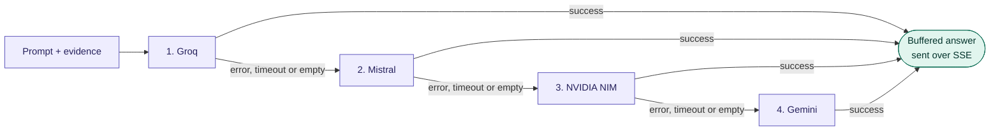
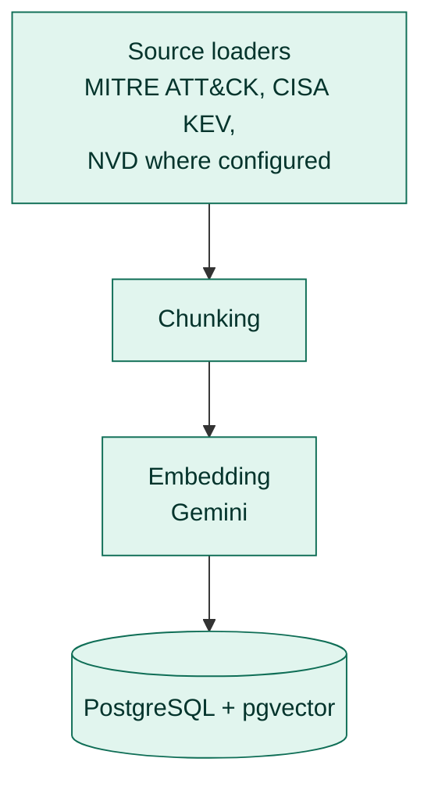
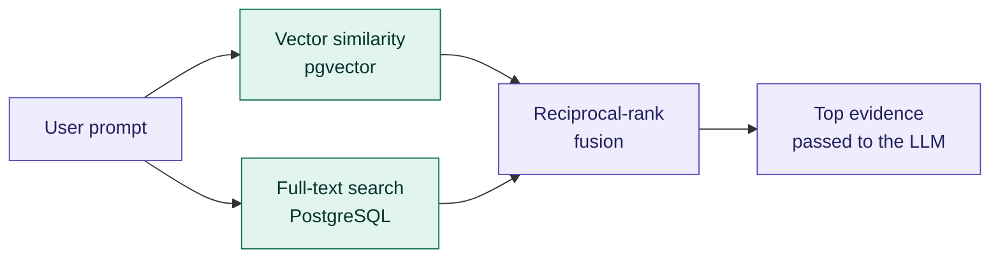

# Cyber Threat Intelligence RAG Backend

A modular FastAPI backend for a cybersecurity knowledge chatbot. It ingests public threat-intelligence data (MITRE ATT&CK, CISA KEV, NVD), retrieves relevant evidence with hybrid search, answers questions through an ordered chain of LLM providers, and screens uploaded evidence for indicators of compromise.

## Table of contents

1. [Features](#features)
2. [Architecture](#architecture)
3. [Project structure](#project-structure)
4. [Tech stack](#tech-stack)
5. [LLM fallback behavior](#llm-fallback-behavior)
6. [Setup (Windows, Python 3.13)](#setup-windows-python-313)
7. [Environment configuration](#environment-configuration)
8. [API reference](#api-reference)
9. [Data ingestion](#data-ingestion)
10. [Testing](#testing)
11. [Troubleshooting](#troubleshooting)
12. [Production hardening](#production-hardening)

---

## Features

- Chat endpoint for cybersecurity and CVE questions, streamed over Server-Sent Events (SSE).
- Hybrid retrieval: pgvector similarity search plus PostgreSQL full-text search, merged with reciprocal-rank fusion.
- Four-provider LLM fallback (Groq, Mistral, NVIDIA NIM, Gemini) with integrity-first streaming.
- Evidence screening endpoint with IOC and heuristic analysis.
- Ingestion from official public sources, with chunking, embedding and storage.
- Clear separation of routes, AI logic, database layer and configuration.

---

## Architecture

> The diagrams below are written in [Mermaid](https://mermaid.js.org/) and render automatically on GitHub.

### System overview



### Chat request flow



### LLM fallback chain



Providers without a configured API key are skipped.

### Ingestion flow



### Hybrid retrieval



### Separation of responsibilities

| Location | Responsibility |
|---|---|
| `app/routes/` | HTTP request and response handling only |
| `app/ai/chat.py` | Chat orchestration, conversation persistence, SSE formatting |
| `app/ai/llm/` | Provider-specific API adapters and the ordered fallback manager |
| `app/ai/rag/` | Chunking, embeddings, ingestion, hybrid retrieval, vector storage |
| `app/ai/screening.py` | Evidence screening and IOC/heuristic analysis |
| `app/db/` | SQLAlchemy models, engine and session lifecycle |
| `app/core/` | Environment-backed configuration and security settings |

---

## Project structure

```text
.
├── app/
│   ├── routes/          # FastAPI route handlers
│   ├── ai/
│   │   ├── chat.py      # ChatService
│   │   ├── screening.py # ScreeningService
│   │   ├── llm/         # Provider adapters + fallback manager
│   │   └── rag/         # Chunking, embed.py, ingestion, retrieval
│   ├── db/              # Models, engine, sessions
│   └── core/            # Settings and security
├── tests/               # pytest suite (mocked providers)
├── server.py            # Entry point
├── requirements.txt
└── .env.example
```

---

## Tech stack

| Area | Technology |
|---|---|
| Web framework | FastAPI |
| Database | PostgreSQL with pgvector and full-text search |
| ORM | SQLAlchemy |
| Streaming | Server-Sent Events (SSE) |
| LLM providers | Groq, Mistral, NVIDIA NIM, Google Gemini |
| Embeddings | Gemini (`app/ai/rag/embed.py`) |
| Testing | pytest |

---

## LLM fallback behavior

Chat generation uses this fixed priority:

1. Groq
2. Mistral
3. NVIDIA NIM
4. Google Gemini

Providers without a configured API key are skipped. If a provider errors, times out, returns an empty answer, or its stream fails, the manager tries the next configured provider.

**Streaming design.** The manager buffers one provider's complete response before returning it. This prevents a partial Groq answer from being mixed with a Mistral, NVIDIA or Gemini answer if the first provider fails mid-stream. The endpoint still uses SSE, but answer chunks are sent after a provider has completed. This favors answer integrity over time-to-first-token.

**Gemini dependency.** Gemini is also used by `app/ai/rag/embed.py` for embeddings. Even if Gemini is only the last chat fallback, its API key remains required by the current embedding architecture.

---

## Setup (Windows, Python 3.13)

1. Install PostgreSQL and enable pgvector:
   ```sql
   CREATE EXTENSION IF NOT EXISTS vector;
   ```
2. Create and activate a virtual environment:
   ```bat
   py -3.13 -m venv .venv
   .venv\Scripts\activate
   ```
3. Install dependencies:
   ```bat
   python -m pip install --upgrade pip
   pip install -r requirements.txt
   ```
4. Copy `.env.example` to `.env`, then set the database URL and API keys.
5. Start the API:
   ```bat
   python server.py
   ```
6. Open Swagger at `http://127.0.0.1:8000/docs`.

Never commit `.env`. Keep it, local caches and virtual environments out of version control.

---

## Environment configuration

See `.env.example` for the full list.

| Variable | Required | Purpose |
|---|---|---|
| `DATABASE_URL` | Yes | PostgreSQL connection string |
| `GEMINI_API_KEY` | Yes | Gemini embeddings; also enables Gemini as the final chat fallback |
| `GROQ_API_KEY` | Optional | Enables Groq as the first chat provider |
| `MISTRAL_API_KEY` | Optional | Enables Mistral as the second chat provider |
| `NVIDIA_API_KEY` | Optional | Enables NVIDIA NIM as the third chat provider |

Model IDs are configurable because provider model availability can change. Use model IDs that are enabled for your account. A valid API key does not guarantee that a model ID is available or that your account has quota.

---

## API reference

### `POST /api/chat`

Ask a cybersecurity question. The response is an SSE stream.

Request body (JSON):

```json
{
  "prompt": "Explain CVE-2024-3400",
  "session_id": "demo"
}
```

- `prompt`: the user question.
- `session_id`: identifies the conversation for history persistence.
- The legacy `question` field is also accepted in place of `prompt`.

### `POST /api/screening`

Screen evidence for indicators of compromise. Send multipart form data:

| Field | Required | Description |
|---|---|---|
| `content` | One of `content` or `file` | Evidence as text |
| `file` | One of `content` or `file` | Evidence as an uploaded file |
| `context` | Optional | Extra context to guide the analysis |

Interactive docs for both endpoints are available in Swagger at `/docs`.

---

## Data ingestion

The ingestion module loads public records from MITRE ATT&CK, CISA KEV and NVD (where configured). Records are chunked, embedded and stored in PostgreSQL with pgvector. Retrieval then uses reciprocal-rank fusion of vector similarity and PostgreSQL full-text results.

Run ingestion through the project's ingestion route if it is enabled and registered in your build. Startup ingestion is disabled by default in `.env.example`, so the development server does not call external APIs on every restart.

---

## Testing

```bat
pytest -q
```

Provider tests should use mocks. They must not consume live API quota.

---

## Troubleshooting

| Symptom | Likely cause and fix |
|---|---|
| A provider is never used | Its API key is not set, so the manager skips it |
| Embedding or ingestion fails | `GEMINI_API_KEY` is missing or has no quota |
| Provider returns a model error | The configured model ID is not enabled for your account; update the model ID in `.env` |
| `type "vector" does not exist` | Run `CREATE EXTENSION IF NOT EXISTS vector;` in your database |
| Chat answers arrive all at once | Expected: each provider's answer is buffered before streaming, to avoid mixed answers |

---

## Production hardening

Before a public SaaS deployment, add:

- [ ] Authentication
- [ ] Tenant-level data isolation
- [ ] API rate limiting
- [ ] Background ingestion workers
- [ ] Upload scanning
- [ ] Request and response size limits
- [ ] Observability
- [ ] Secret management
- [ ] Database migrations
- [ ] Retention controls
- [ ] Provider cooldown and circuit-breaker state shared across workers
